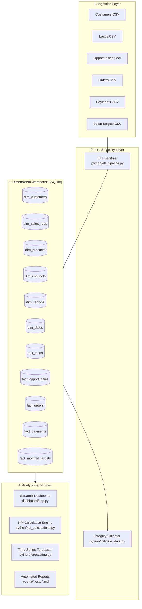
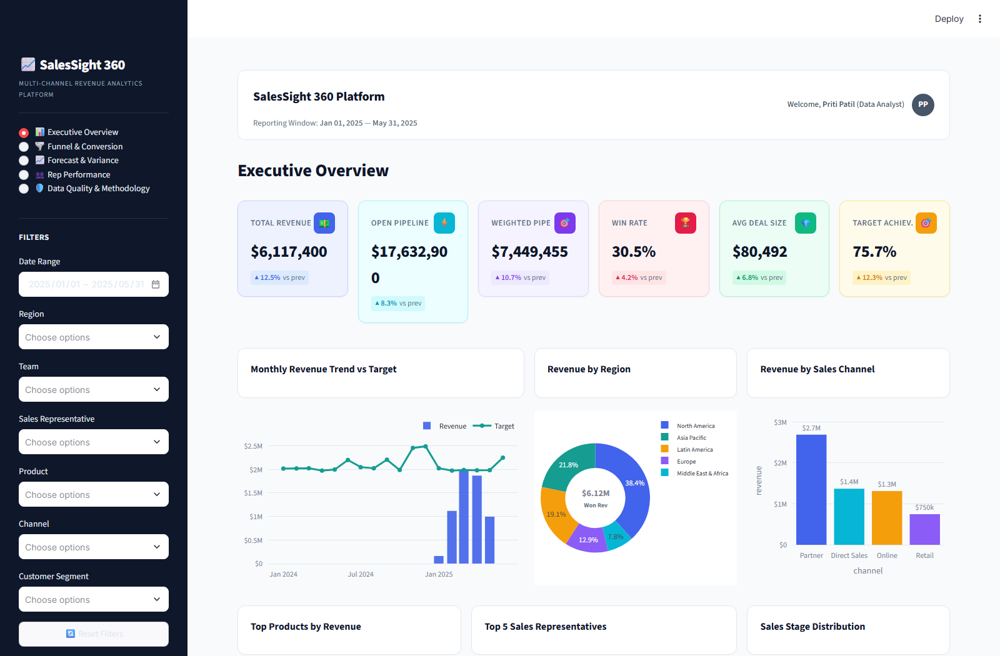
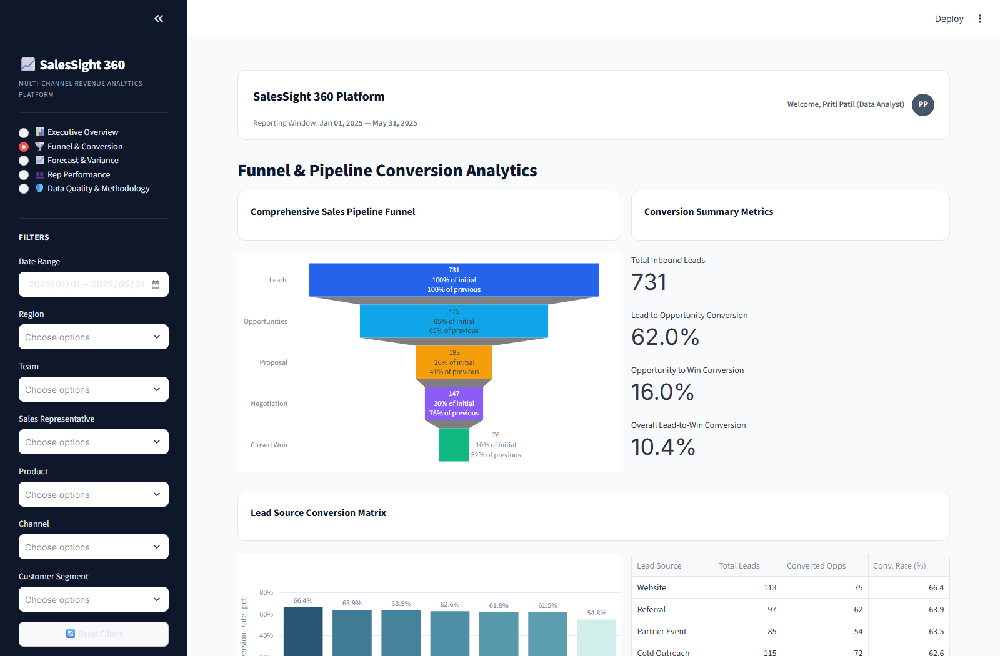
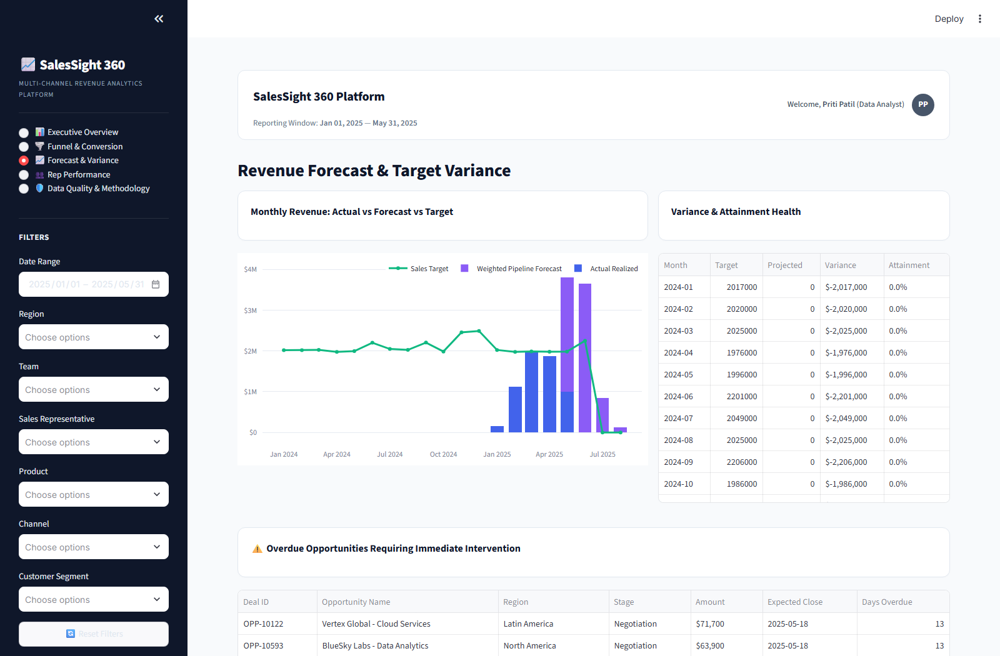
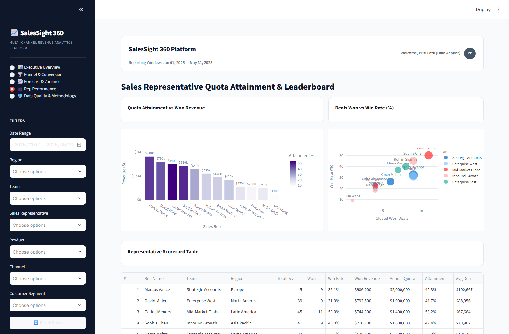

# SalesSight 360 — Multi-Channel Revenue Analytics & Intelligence Platform

[](https://www.python.org/)
[](https://streamlit.io/)
[](https://www.sqlite.org/)
[-success.svg)]()
[]()

> **SalesSight 360** is an enterprise-grade revenue analytics platform that bridges raw transactional sales data and executive decision-making. Featuring a Kimball-style dimensional star-schema warehouse, automated ETL data cleaning, rigorous statistical validation, machine learning revenue forecasting, and an executive Streamlit BI dashboard.
>       Repo Link -https://github.com/aishpatil1525-creator/salessight360-A.git
>      Documentation Link -https://drive.google.com/file/d/1NDfe9Bfep59GRelzBYyYrrHrGDC0UzSu/view?usp=sharing
       Demo Link-https://drive.google.com/file/d/12fIs33QQY_Qz12wN2EqakCL6brV1J_YK/view?usp=drive_link

## 📑 Table of Contents

- [Key Features](#-key-features)
- [System Architecture](#-system-architecture)
- [Repository Structure](#-repository-structure)
- [Quick Start Guide](#-quick-start-guide)
- [Pipeline Orchestration](#-pipeline-orchestration)
- [Interactive Dashboard](#-interactive-dashboard)
- [Dashboard Screenshots](#-dashboard-screenshots)
- [Automated Testing & Data Quality](#-automated-testing--data-quality)
- [Reports & Analytics Exports](#-reports--analytics-exports)

---

## ✨ Key Features

1. **Dimensional Star-Schema Warehouse**:
   - 11 normalized dimension and fact tables in SQLite (`data/processed/sales_sight_360.db`).
   - Clean separation of recognized revenue, closed-won deal value, and open pipeline to prevent double counting.
2. **Automated ETL & Sanitization Pipeline**:
   - Cleans duplicate records, reconciles customer and rep foreign keys, standardizes stage names, and validates probability bounds.
3. **Core Business KPI Engine**:
   - 15 core executive metrics including Recognized Revenue, Closed-Won Value, Weighted Pipeline, Unbiased Win Rate, Quota Attainment, and Sales Velocity.
4. **Interactive Executive BI Dashboard**:
   - 5 comprehensive analytics views with high-end dark SaaS styling, KPI delta cards, interactive Plotly charts, cohort heatmaps, and funnel diagrams.
5. **90-Day Revenue Forecasting**:
   - Built-in time-series modeling (Holt-Winters / ARIMA) with 80% & 95% confidence intervals and dynamic scenario projections (+15% / -15%).
6. **Automated Verification & Reporting**:
   - 22 automated unit/integration tests and 22 data integrity assertions with 100% pass rate.
   - One-click report exports in CSV and Markdown.

---

## 🏛 System Architecture



---

## 📂 Repository Structure

```text
SalesSight_360/
├── dashboard/
│   └── app.py                      # Streamlit interactive executive BI dashboard
├── data/
│   ├── raw/                        # Raw synthetic enterprise sales CSVs
│   │   ├── customers.csv
│   │   ├── leads.csv
│   │   ├── orders.csv
│   │   ├── payments.csv
│   │   ├── sales_opportunities.csv
│   │   ├── sales_reps.csv
│   │   └── sales_targets.csv
│   └── processed/                  # Cleaned star-schema CSVs & SQLite database
│       ├── dim_customers.csv
│       ├── dim_sales_reps.csv
│       ├── dim_products.csv
│       ├── dim_channels.csv
│       ├── dim_regions.csv
│       ├── dim_dates.csv
│       ├── fact_leads.csv
│       ├── fact_opportunities.csv
│       ├── fact_orders.csv
│       ├── fact_payments.csv
│       ├── fact_monthly_targets.csv
│       └── sales_sight_360.db      # SQLite Star-Schema Data Warehouse
├── docs/
│   └── architecture.md             # Technical architecture & dimensional data model
├── python/
│   ├── generate_sample_data.py     # Deterministic synthetic enterprise data generator
│   ├── etl_pipeline.py             # ETL pipeline & SQLite warehouse builder
│   ├── validate_data.py            # 22-point data quality & integrity assertion engine
│   ├── kpi_calculations.py         # Business KPI calculation engine
│   ├── forecasting.py              # Holt-Winters / ARIMA 90-day revenue forecasting
│   ├── generate_reports.py         # Automated executive analytical report generator
│   ├── capture_screenshots.py      # Headless Playwright script for dashboard screenshots
│   └── run_all.py                  # Master orchestration script
├── reports/                        # Exported analytical CSVs and executive summary
│   ├── executive_kpi_summary.csv
│   ├── channel_performance_report.csv
│   ├── regional_performance_report.csv
│   ├── rep_quota_attainment_report.csv
│   └── executive_revenue_report.md
├── screenshots/                    # Captured high-resolution dashboard screenshots
│   ├── executive_overview.png
│   ├── funnel_conversion.png
│   ├── forecast_variance.png
│   ├── rep_performance.png
│   ├── data_quality.png
│   └── filtered_view.png
├── sql/                            # Production SQL analytical queries and DDL
│   ├── schema.sql                  # Dimensional DDL schema & indexes
│   ├── kpi_queries.sql             # Executive revenue & quota SQL queries
│   ├── funnel_analysis.sql         # Stage transition & lead conversion SQL
│   ├── forecast_analysis.sql       # Monthly variance & quota attainment SQL
│   └── data_quality_checks.sql     # Automated SQL data quality audit suite
├── tests/                          # Automated unit and integration test suite
│   ├── test_data_generation.py
│   ├── test_etl.py
│   ├── test_data_integrity.py
│   ├── test_kpis.py
│   └── run_tests.py                # Master test runner
├── requirements.txt                # Python package dependencies
└── README.md                       # Project documentation
```

---

## 🚀 Quick Start Guide

### 1. Prerequisites
- Python 3.10+ installed
- PowerShell / Bash terminal

### 2. Install Dependencies
```bash
pip install -r requirements.txt
```

### 3. Run the End-to-End Pipeline
Run the master orchestration script to generate data, build the SQLite warehouse, validate data quality, run all automated tests, and export executive reports:
```bash
python python/run_all.py
```

### 4. Launch the Interactive Dashboard
```bash
streamlit run dashboard/app.py
```
Open your browser at `http://localhost:8501`.

---

## 🔄 Pipeline Orchestration

The master pipeline (`python/run_all.py`) runs all stages deterministically:

```text
**********************************************************************
  SALESSIGHT 360 — END-TO-END PIPELINE ORCHESTRATION
**********************************************************************
>>> Step 1: Generate Synthetic Datasets
>>> Step 2: Execute ETL & Build SQLite Warehouse
>>> Step 3: Run Data Quality & Integrity Checks (22/22 Passed)
>>> Step 4: Execute Automated Test Suite (22/22 Passed)
>>> Step 5: Generate Executive Analytical Reports
**********************************************************************
  ALL PIPELINE STAGES COMPLETED SUCCESSFULLY
**********************************************************************
```

---

## 📊 Interactive Dashboard

The Streamlit dashboard (`dashboard/app.py`) provides 5 dedicated views:

1. **Executive Overview**: High-level revenue cards, monthly targets vs. actuals, multi-channel performance, and product mix.
2. **Funnel & Conversion**: Stage-by-stage pipeline drop-off, lead-to-opportunity velocity, and loss reason breakdown.
3. **Forecast & Variance**: 90-day forward projection with confidence bands, quarterly forecast variance, and scenario modeling (+15% / -15%).
4. **Rep Performance**: Sales representative quota attainment leaderboard, deal size distributions, and activity metrics.
5. **Data Quality & Methodology**: Live warehouse audit status, reconciliation metrics, and documented KPI calculation formulas.

---

## 📸 Dashboard Screenshots

| View | Screenshot |
|---|---|
| **Executive Overview** |  |
| **Funnel & Conversion** |  |
| **Forecast & Variance** |  |
| **Rep Performance** |  |
| **Data Quality & Methodology** |  |
| **Filtered View** |  |

---

## 🧪 Automated Testing & Data Quality

Run the test suite independently:
```bash
python tests/run_tests.py
```

### Test Suite Summary:
- `test_data_generation`: Validates record volumes, schema shapes, and non-empty outputs.
- `test_etl`: Asserts duplicate removal, stage name normalization, and column types.
- `test_data_integrity`: Verifies foreign key relationships, non-negative monetary amounts, and chronological date integrity.
- `test_kpis`: Validates division-by-zero protection, win-rate edge cases, and weighted pipeline mathematics.

**Result**: 22 / 22 Tests Passed (100% Success Rate).

---

## 📄 Reports & Analytics Exports

Automated executive reports are located in `reports/`:
- `executive_kpi_summary.csv` — Primary headline numbers.
- `channel_performance_report.csv` — Win rates, revenue, and deal volume per sales channel.
- `regional_performance_report.csv` — Geographical revenue and pipeline metrics.
- `rep_quota_attainment_report.csv` — Individual rep quota attainment rankings.
- `executive_revenue_report.md` — Formatted executive intelligence report.

---
*Developed as an enterprise revenue analytics showcase for SalesSight 360.*
