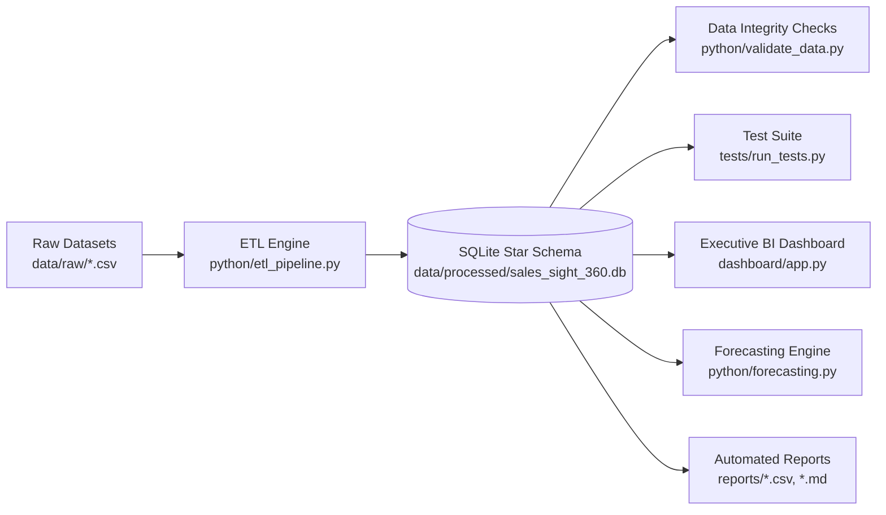
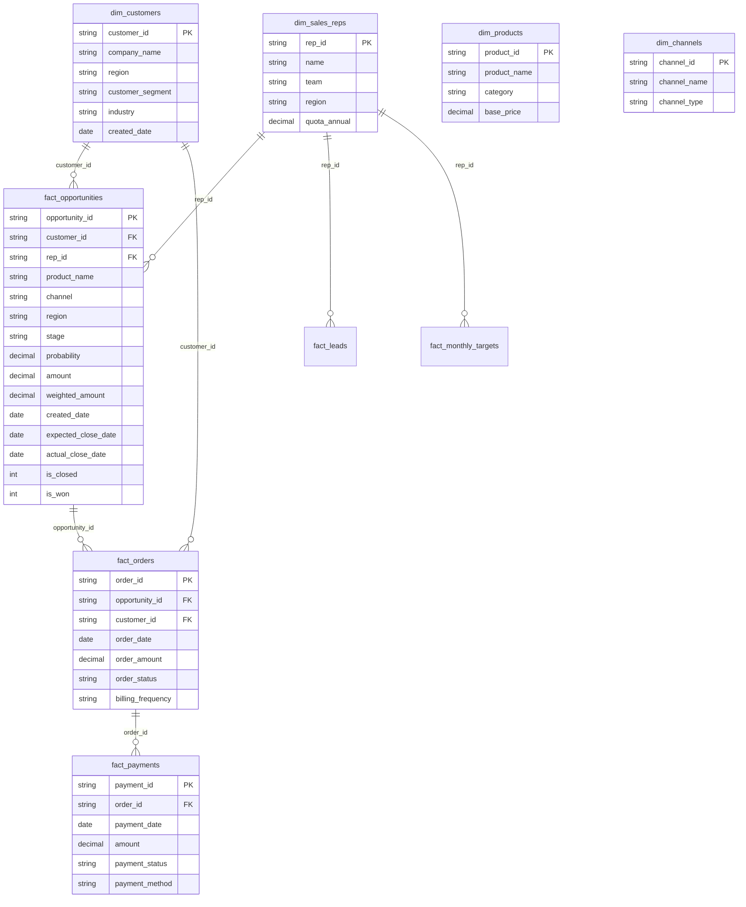

# SalesSight 360 — Architecture & Data Warehouse Documentation

## 1. System Architecture Overview

SalesSight 360 is an enterprise multi-channel revenue analytics and intelligence platform built on a dimensional star-schema warehouse. The architecture spans five core stages:

---

## 2. Dimensional Data Model (Star Schema)

The warehouse implements a Kimball-style dimensional model centered around business events (Leads, Opportunities, Orders, Payments, Targets) and shared dimensions (Customers, Sales Reps, Products, Channels, Regions, Dates).

---

## 3. Core KPI Definitions & Methodologies

1. **Total Recognized Revenue**:
   $$\text{Recognized Revenue} = \sum_{\text{status} = \text{'Completed'}} \text{Payment Amount}$$
   *Prevents double counting across multiple recurring invoices and separates cash realization from deal bookings.*

2. **Closed-Won Deal Value**:
   $$\text{Closed-Won Value} = \sum_{\text{stage} = \text{'Closed Won'}} \text{Opportunity Amount}$$

3. **Weighted Pipeline**:
   $$\text{Weighted Pipeline} = \sum (\text{Amount} \times \text{Stage Probability})$$
   - Prospecting: 10%
   - Qualification: 25%
   - Proposal: 50%
   - Negotiation: 75%
   - Closed Won: 100%
   - Closed Lost: 0%

4. **Unbiased Win Rate**:
   $$\text{Win Rate (\%)} = \frac{\text{Closed Won Deals}}{\text{Closed Won Deals} + \text{Closed Lost Deals}} \times 100$$
   *Excludes in-flight open deals from the denominator to ensure statistical accuracy.*

5. **Quota Attainment**:
   $$\text{Attainment (\%)} = \frac{\text{Closed Won Revenue}}{\text{Annual Quota}} \times 100$$

---

## 4. Forecasting Engine

- **Model**: Holt-Winters Exponential Smoothing & ARIMA with seasonal trend decomposition.
- **Horizon**: 90-day rolling forward projection with 80% and 95% confidence intervals.
- **Scenario Analysis**: Dynamic best-case (+15%), expected, and worst-case (-15%) sensitivity testing.

---

## 5. Automated Data Quality & Verification

22 distinct assertions run on every pipeline build:
- Table existence & schema completeness
- Primary key uniqueness across all 11 tables
- Foreign key referential integrity (zero orphaned records)
- Business bounds (strictly positive monetary amounts, probability $\in [0.0, 1.0]$)
- Chronological consistency ($\text{Close Date} \ge \text{Created Date}$)
- Record reconciliation between raw inputs and cleaned star-schema tables
